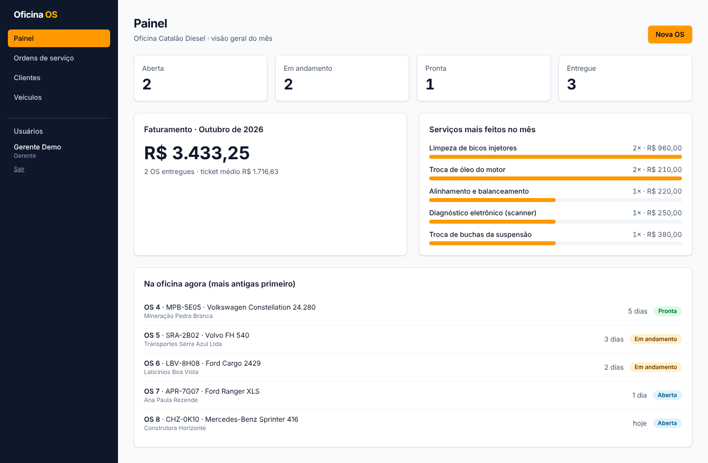
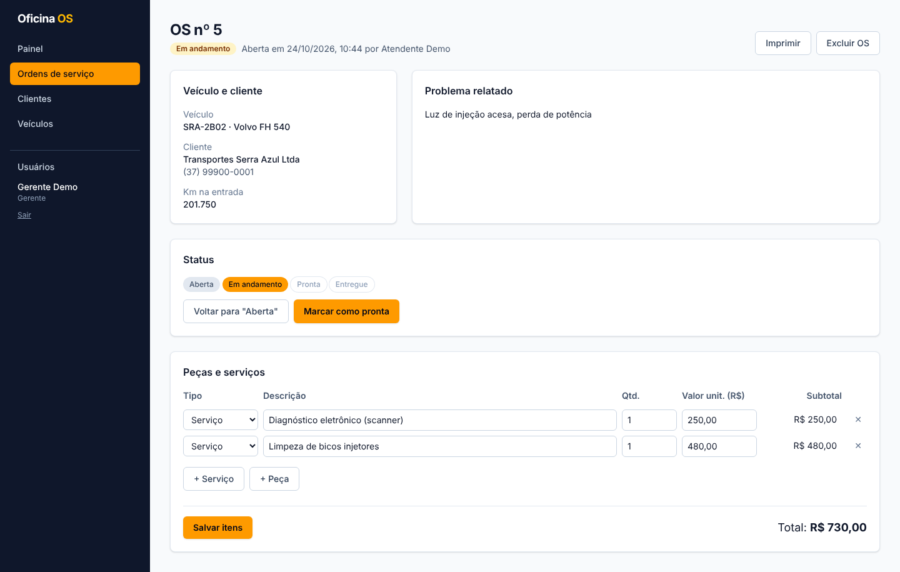
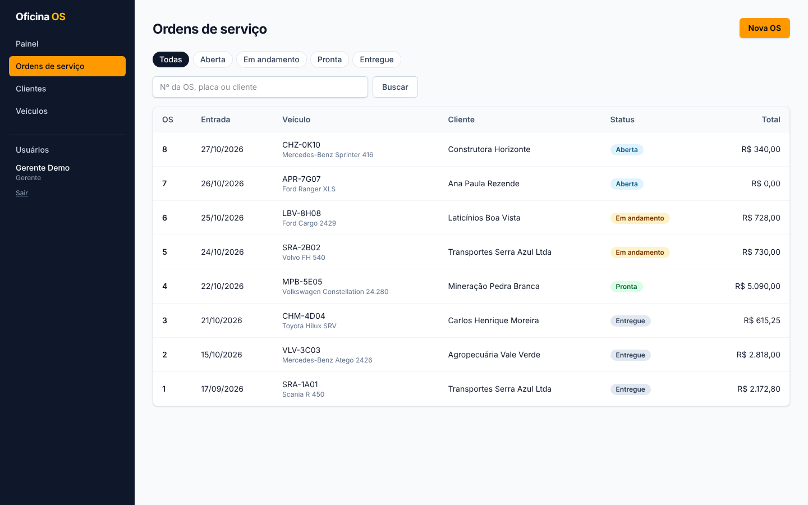
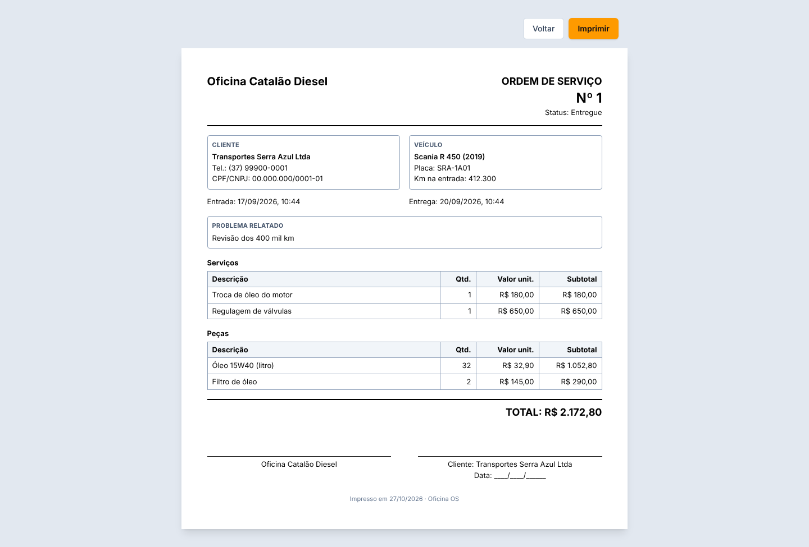
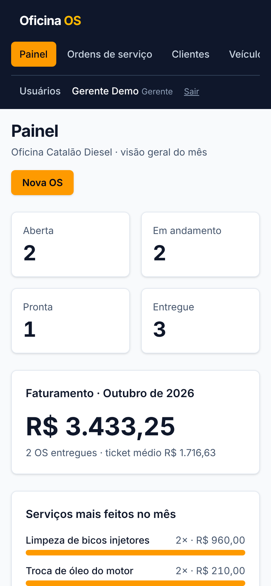

# Oficina OS

Sistema de **ordens de serviço** para oficina mecânica de linha diesel, feito para a
Oficina Catalão Diesel (Divinópolis, MG). Controla clientes, veículos e ordens de
serviço do começo ao fim: da entrada do caminhão até a impressão da OS para o cliente
assinar.

**👉 [Ver a demonstração](https://SEU-LINK-DA-DEMO.vercel.app/demo)**: um clique e
você entra como gerente, com dados fictícios.



## Funcionalidades

- **Ordens de serviço**: abertura a partir do veículo, lançamento de peças e
  serviços com prévia do total em tempo real, fluxo de status
  (Aberta → Em andamento → Pronta → Entregue) e impressão em A4.
- **Clientes e veículos**: cadastro com validação (placa antiga e Mercosul),
  histórico de OS por veículo e busca pela URL.
- **Painel do mês**: OS por status, faturamento do mês, serviços mais feitos e a
  fila da oficina (o que está parado há mais tempo).
- **Login com papéis**: *gerente* (tudo, inclusive excluir, ver o faturamento e
  criar usuários) e *atendente* (cadastros e OS).
- **Funciona no celular**, para usar no pátio.

| Ordem de serviço | Lista de OS |
|---|---|
|  |  |

| Impressão (A4) | Celular |
|---|---|
|  |  |

## Tecnologias

- **Next.js 16** (App Router, Server Components, Server Actions, Cache Components,
  streaming com Suspense, `proxy.ts`)
- **TypeScript** e **Tailwind CSS 4**
- **PostgreSQL** (Neon) com **Drizzle ORM** e migrations
- **Zod** para validação, **iron-session** + **bcrypt** para login
- **Vitest** (regras de negócio) e **Playwright** (teste de ponta a ponta)
- Deploy na **Vercel**

## Decisões técnicas

- **Dinheiro em centavos** (inteiros), nunca em `float`: `0.1 + 0.2` não dá `0.3`
  em JavaScript. O total da OS é sempre recalculado **no servidor**, dentro de uma
  **transação** com `SELECT ... FOR UPDATE`.
- **Regras de negócio como funções puras** (`src/lib/regras-os.ts`): usadas no
  servidor para valer de verdade e no navegador para a prévia, e testadas com Vitest.
- **Segurança em camadas**: o `proxy.ts` redireciona quem não está logado, mas a
  checagem que vale fica na camada de dados (`src/lib/auth.ts`), chamada por toda
  página e toda Server Action.
- **Integridade no banco**: placa `UNIQUE`, status como `enum`, e exclusões
  bloqueadas (`ON DELETE RESTRICT`) para não apagar o histórico da oficina.
- **iron-session em vez de Auth.js**: o Auth.js entrou em modo de manutenção, e a
  documentação do Next 16 usa iron-session nos exemplos de autenticação. Para login
  de funcionários com e-mail e senha, é simples e auditável.

O modelo de dados, com diagrama, está em [docs/modelo-de-dados.md](docs/modelo-de-dados.md).

## Como rodar no seu computador

Pré-requisitos: Node.js 20 ou mais novo e um banco PostgreSQL (o plano grátis do
[Neon](https://neon.tech) serve).

```bash
# 1. Instalar as dependências
npm install

# 2. Criar o .env a partir do exemplo e preencher DATABASE_URL e SESSION_PASSWORD
cp .env.example .env        # no Windows (PowerShell): copy .env.example .env

# 3. Criar as tabelas e preencher com dados de exemplo
npm run db:migrate
npm run db:seed -- --sim    # ⚠️ apaga tudo antes; nunca rode no banco da oficina

# 4. Rodar
npm run dev
```

Abra http://localhost:3000 e entre com `gerente@oficina.dev` / `demo1234`
(ou `atendente@oficina.dev` / `demo1234` para ver o papel de atendente).

### Scripts

| Comando | O que faz |
|---|---|
| `npm run dev` | Servidor de desenvolvimento |
| `npm run build` | Build de produção (o mesmo que a Vercel roda) |
| `npm test` | Testes de unidade (Vitest) |
| `npm run test:e2e` | Teste de ponta a ponta (Playwright). Na 1ª vez: `npx playwright install chromium` |
| `npm run db:generate` | Gera uma migration depois de mudar `src/db/schema.ts` |
| `npm run db:migrate` | Aplica as migrations no banco do `.env` |
| `npm run db:seed -- --sim` | Apaga tudo e insere os dados de exemplo |
| `npm run db:studio` | Abre o Drizzle Studio para ver as tabelas |

## Deploy

São **dois projetos na Vercel**, apontando para o mesmo repositório:

| | Oficina (produção) | Demonstração |
|---|---|---|
| Banco | Neon com os dados reais | Outro banco Neon, só com dados do seed |
| `DATABASE_URL` | banco real | banco da demo |
| `SESSION_PASSWORD` | uma senha | outra senha |
| `DEMO_MODE` | `false` | `true` |

Depois de configurar as variáveis em *Settings → Environment Variables*, rode as
migrations apontando para cada banco (troque a `DATABASE_URL` no seu `.env`
temporariamente, ou use o SQL Editor do Neon com o arquivo da pasta `drizzle/`).

## Estrutura

```
src/
├── app/
│   ├── (sistema)/        páginas internas com menu lateral (painel, ordens, clientes, veículos, usuários)
│   ├── login/            tela de login e Server Actions de entrar/sair
│   ├── demo/route.ts     link de 1 clique para a demonstração
│   └── imprimir/         OS em formato A4, sem menu
├── components/           formulários (Client Components) e peças visuais
├── db/                   schema do Drizzle, conexão e seed
├── lib/
│   ├── dados/            consultas ao banco (camada de dados)
│   ├── regras-os.ts      regras de negócio da OS (+ testes)
│   ├── validacao.ts      esquemas Zod (+ testes)
│   ├── formato.ts        moeda, datas e placa no padrão brasileiro (+ testes)
│   └── auth.ts           sessão e permissões
└── proxy.ts              redireciona quem não está logado
e2e/                      teste Playwright do fluxo completo
docs/                     modelo de dados e prints
```

## Autor

José Maria Zaltar · Desenvolvedor Full Stack · Divinópolis, MG
