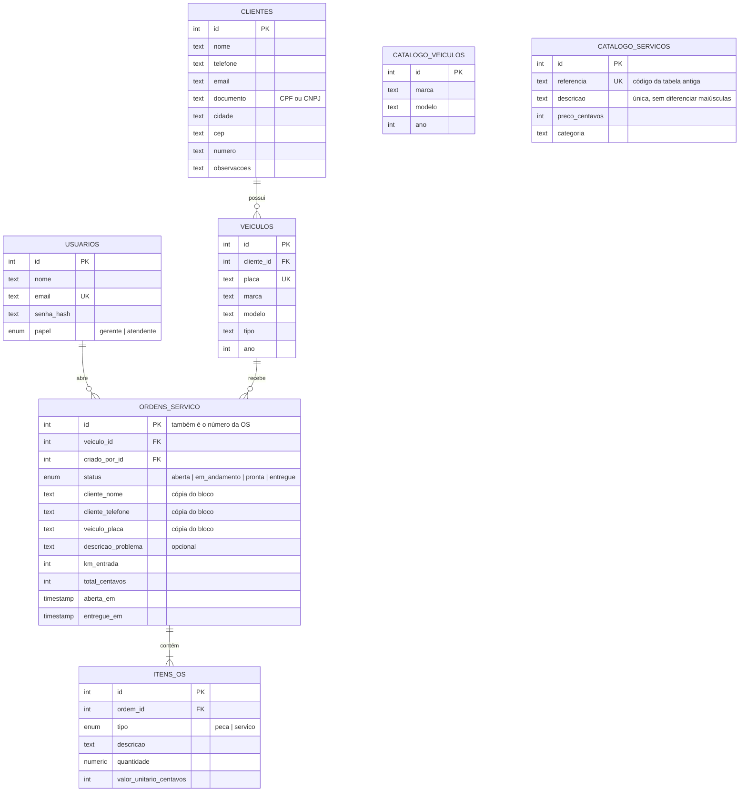
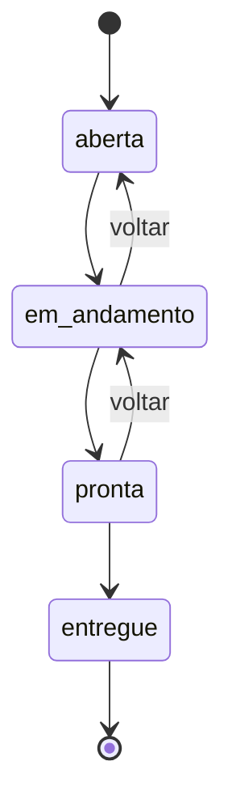

# Modelo de dados

O GitHub desenha o diagrama abaixo automaticamente (é Mermaid).

## Como explicar em voz alta

- **Um cliente tem vários veículos** (1:N). Por isso a chave estrangeira
  `cliente_id` fica na tabela de **veículos**, o lado "muitos".
- **Um veículo tem várias ordens de serviço** ao longo do tempo (1:N). A OS
  aponta para o veículo, não para o cliente. O cliente é descoberto pelo veículo,
  e assim não existe risco de a OS dizer um dono e o veículo dizer outro.
- **Uma OS tem vários itens** (peças e serviços). Cada item tem quantidade e
  valor unitário. O total da OS é a soma de `quantidade × valor_unitario`.
- **Cada OS guarda quem abriu** (`criado_por_id`, ligado a usuários).

## Decisões importantes

| Decisão | Por quê |
|---|---|
| Dinheiro em **centavos** (inteiro) | Números com vírgula no computador têm erro de arredondamento (`0.1 + 0.2 = 0.30000000000000004`). Em centavos, R$ 12,50 vira `1250` e a conta é exata. |
| `total_centavos` **guardado** na OS | Poderia ser calculado sempre a partir dos itens, mas guardar deixa as listas e o painel rápidos. Ele é recalculado **no servidor**, dentro de uma transação, toda vez que os itens mudam. |
| Status como **enum** | O banco só aceita os 4 valores válidos. Um erro de digitação como "pronto" é barrado pelo próprio PostgreSQL. |
| Excluir com **restrict** | Não dá para excluir um cliente que tem veículos, nem um veículo que tem OS. Isso protege o histórico da oficina. Os itens são apagados junto com a OS (**cascade**), porque não fazem sentido sozinhos. |
| **Catálogo** de marca/modelo/ano separado | Alimenta as sugestões do formulário de veículo e continua existindo mesmo se o veículo for excluído. O índice único usa `lower()`, então "Scania" e "SCANIA" contam como a mesma marca, e o veículo é gravado com a grafia que já existia. |
| OS guarda a **cópia do cabeçalho** (nome, tel, cidade, CEP, nº, placa, marca, modelo, tipo) | Igual ao bloco de papel: a OS mostra o que foi escrito nela. Se o atendente mudar o telefone só para esta OS, o cadastro do cliente continua como estava. |
| **Placa nova** cadastra cliente e veículo | Ao abrir a OS com uma placa que o sistema não conhece, o veículo é cadastrado. O cliente é reaproveitado se já existir um com o mesmo nome (dono de frota); senão, é cadastrado também. Tudo numa transação. |
| **Tabela de serviços** (área Serviços) | Código, descrição, preço e categoria. Na OS, escolher um serviço preenche o preço. Cada descrição nova usada numa OS também entra aqui, com o preço usado. Sem repetir: "TROCA DE ÓLEO" é gravada como "Troca de óleo" se essa grafia já existir. A oficina lança só serviços, então o tipo de cada item é sempre "serviço". |
| Placa **única** | Duas fichas para o mesmo caminhão causariam confusão no histórico. |

## Fluxo de status da OS

- A OS anda **uma etapa por vez** e pode voltar uma etapa, por exemplo quando
  o cliente reclama antes de buscar o veículo.
- **Entregue é final**: não volta mais.
- Os itens só podem ser alterados com a OS **aberta** ou **em andamento**.

As regras estão em `src/lib/regras-os.ts` e têm testes em
`src/lib/regras-os.test.ts`.
